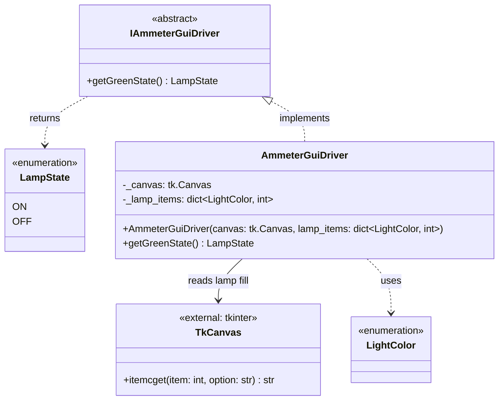

# Ammeter Abstraction Class Diagram

`LightColor` is imported from `TrafficLight.py` and `LAMP_COLORS` from
`TrafficLightAbstraction.py`. `getGreenState()` returns `ON` when the green
lamp's fill equals `LAMP_COLORS[LightColor.GREEN]`, otherwise `OFF`.
