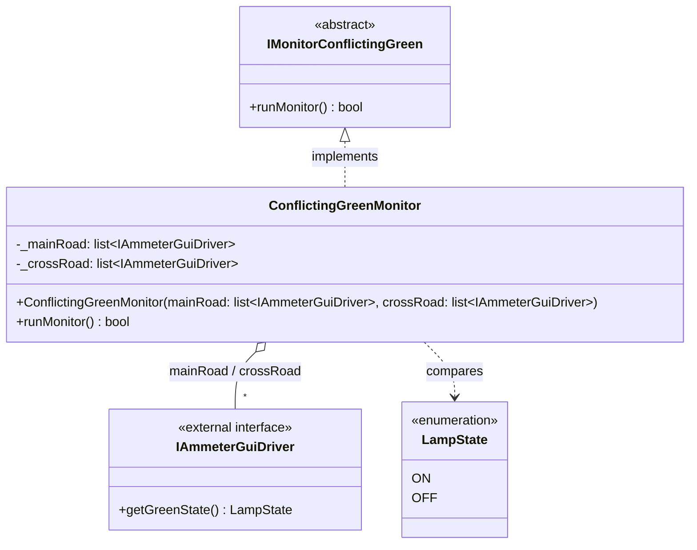

# Conflicting Green Monitor Class Diagram

`IAmmeterGuiDriver` and `LampState` are imported from `AmmeterAbstraction.py`.
`runMonitor()` returns `True` (conflict) when at least one ammeter on the main
road and at least one on the cross road report `LampState.ON`.
