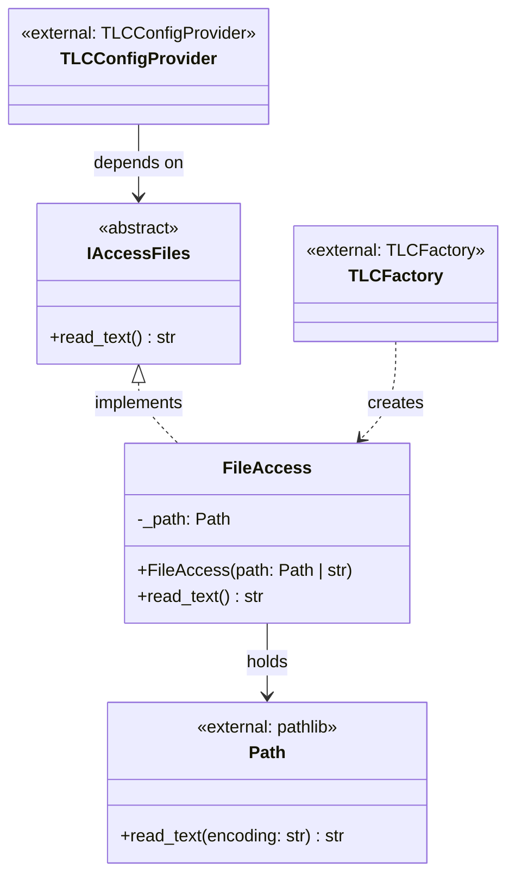

# File Access Class Diagram

`IAccessFiles` and `FileAccess` are defined in `HAL/FileAccess.py`.
`FileAccess` is created with the file path, converts it to `Path`, and
`read_text()` returns the full file content decoded as UTF-8.
`TLCConfigProvider` depends only on `IAccessFiles`, so another implementation
(for example, an in-memory one for tests) can be injected.
