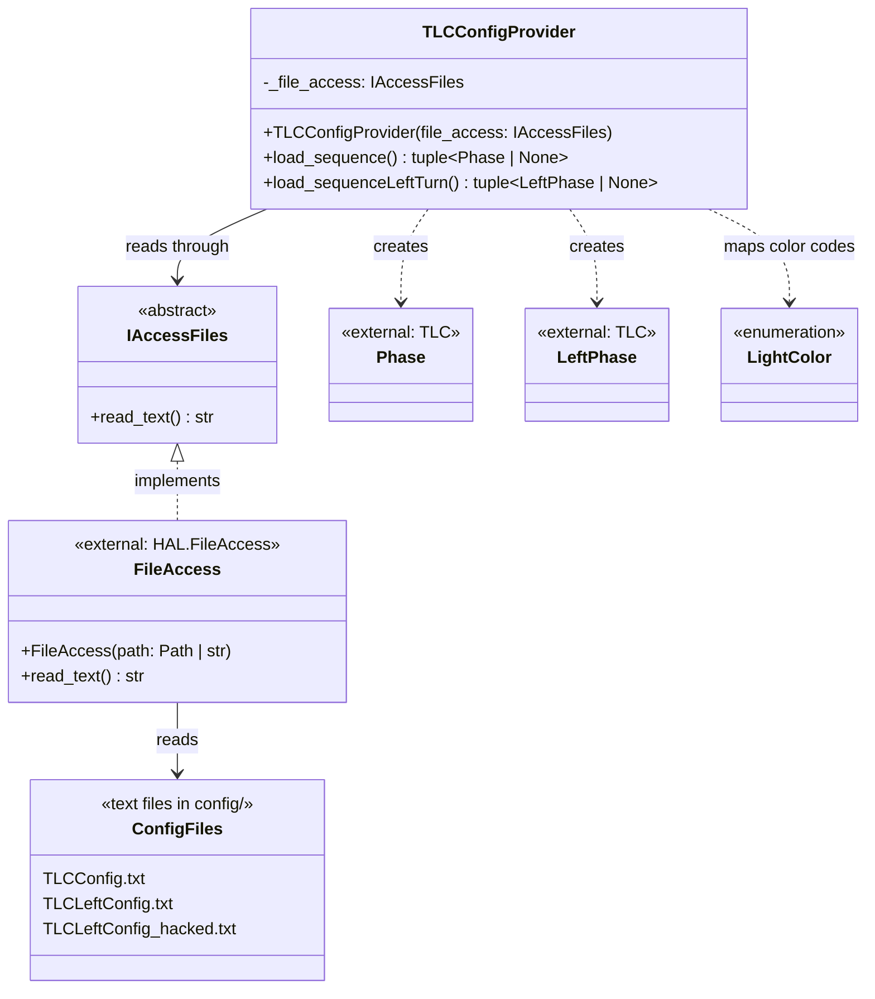

# TLC Config Provider Class Diagram

`Phase` and `LeftPhase` are imported from `TLC.py`; `LightColor` is imported
from `TrafficLight.py`; `IAccessFiles` is imported from `HAL/FileAccess.py`.
Both load methods parse the text returned by the injected `IAccessFiles`, so the
provider does not know file paths. See `FileAccess_ClassDiagram.md`.
