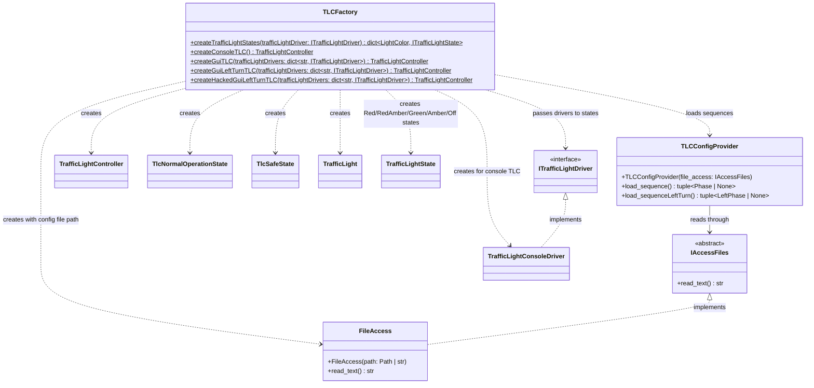

# TLC Factory Class Diagram

The diagram focuses on the types used directly by the factory methods; sequence
values are omitted. The factory creates a `FileAccess` for `config/TLCConfig.txt`,
`config/TLCLeftConfig.txt`, or `config/TLCLeftConfig_hacked.txt` and injects it
into `TLCConfigProvider`.
