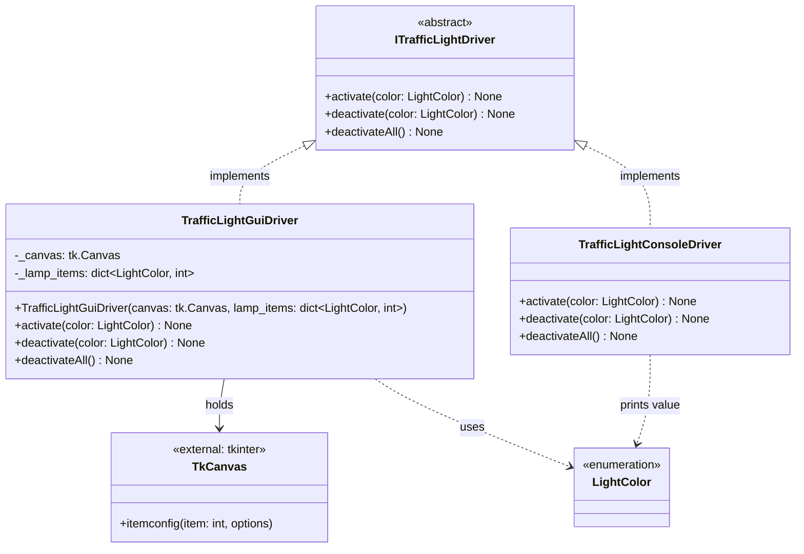

# Traffic Light Driver Class Diagram

`LightColor` is imported from `TrafficLight.py`. The module-level `LIT_LAMPS`,
`LAMP_COLORS`, and `OFF_COLOR` constants determine which lamp items are lit and
which fill colors are applied. `TrafficLightConsoleDriver.activate()` prints the
color value; `deactivate()` and `deactivateAll()` do nothing.
